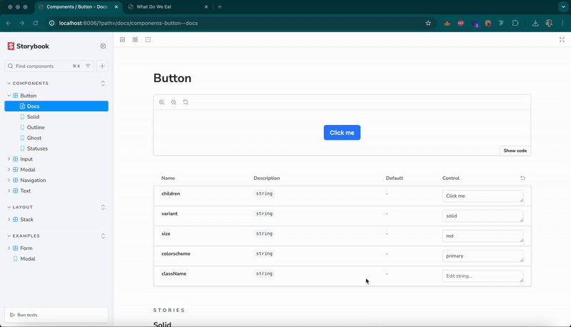

# Components Library

A small library of reusable React components, built with TypeScript and Tailwind CSS and documented in Storybook. It is meant as the base of a design system: the same look and the same API from one project to the next.



## What's inside

| Component | What it does | Main props |
| --- | --- | --- |
| `Button` | Action button | `variant` (`solid`, `outline`, `ghost`), `size` (`sm`, `md`, `lg`), `colorscheme` (`primary`, `secondary`, `success`, `warning`, `danger`) |
| `Input` | Text field with its label | `label`, `name`, plus every native `<input>` attribute |
| `Text` | Typography | `as` (any element, `p` by default), `size`, `weight`, `align`, `emphasis` |
| `Modal` | Dialog over the page, closes on a click outside | `isOpen`, `onClose` |
| `Navbar` | Top navigation with brand and links | `logo`, `brand`, `links`, `outline`, `size`, `fixed`, `themeOnScroll` |
| `Box`, `Stack` | Layout primitives | every native `<div>` attribute |

Two composed examples live in Storybook: a login form and a modal with state.

How it is built:

- **Typed variants** with [class-variance-authority](https://cva.style): each variant is a prop with autocompletion, and invalid values fail type checking.
- **Class merging** with `clsx` and `tailwind-merge`: a `className` you pass overrides the component's own classes instead of fighting them.
- **React 19 refs**: `ref` is a regular prop, no `forwardRef`.
- **Accessibility**: the modal has `role="dialog"` and `aria-modal="true"`, and the code is linted with `eslint-plugin-jsx-a11y`.

## Install

The library is installed from this repository, pinned to a release tag:

```bash
pnpm add github:npier97/Components-Library#v3.0.1
```

It needs React 19 in your project (`react` and `react-dom` are peer dependencies).

## Use

Import the components, and the stylesheet once at the root of your app:

```tsx
import { useState } from "react";
import { Button, Modal, Text } from "components-library";
import "components-library/styles.css";

export function Example() {
  const [open, setOpen] = useState(false);

  return (
    <>
      <Button variant="outline" colorscheme="primary" onClick={() => setOpen(true)}>
        Open
      </Button>
      <Modal isOpen={open} onClose={() => setOpen(false)}>
        <Text as="h2" size="xl" weight="semibold">Hello</Text>
      </Modal>
    </>
  );
}
```

The package ships an ES module, a UMD/CommonJS build and a single bundled `.d.ts` file, mapped in `exports`:

| Import | File |
| --- | --- |
| `components-library` (import) | `dist/components-library.js` |
| `components-library` (require) | `dist/components-library.umd.cjs` |
| types | `dist/components-library.d.ts` |
| `components-library/styles.css` | `dist/components-library.css` |

`react`, `react-dom` and `react/jsx-runtime` are left out of the bundle and come from your app.

## Develop

Requirements: Node 20.19 or later, pnpm.

```bash
pnpm install
pnpm storybook        # Storybook on http://localhost:6006
pnpm build            # type check, then build the library into dist/
pnpm lint             # ESLint, with the jsx-a11y rules
pnpm build-storybook  # static Storybook
```

Every component has its stories next to it (`src/components/<Name>/index.stories.tsx`). Add a story with each new component or variant: it is the documentation.

## Release

Versions follow [semantic versioning](https://semver.org):

- **major** (`2.0.0` → `3.0.0`): breaking changes to a component's API;
- **minor** (`3.0.0` → `3.1.0`): new components or props, backward compatible;
- **patch** (`3.0.0` → `3.0.1`): bug fixes.

`dist/` is committed, because projects install the library straight from a Git tag. To release:

```bash
pnpm build
git add .
git commit -m "feat: describe the change"
pnpm version minor    # or patch / major: bumps package.json and creates the tag
git push --follow-tags
```

Projects then move to the new tag in their `package.json`.

## Known limits

- `Modal` closes on a click outside, but not yet with the Escape key, and it does not trap focus inside the dialog.
- The library is not published on npm: install it from a Git tag as shown above.

## Stack

React 19 · TypeScript · Tailwind CSS 4 · class-variance-authority · Vite (library mode) · Storybook 10 (Docs, Chromatic) · ESLint
